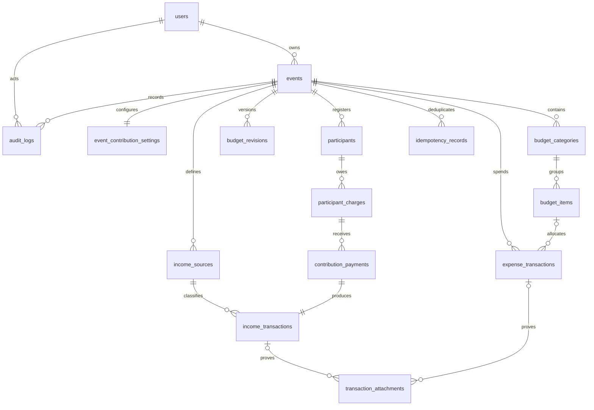

# Database — EventFund v1.0

Model fisik PostgreSQL untuk implementasi Prisma. Dokumen ini adalah kontrak schema dan migration; bukan klaim bahwa schema.prisma atau migration sudah dibuat. Semua aturan perhitungan/status mengikuti [BUSINESS_RULES](BUSINESS_RULES.md). Buat migration SQL tambahan untuk CHECK, expression/partial index, dan trigger yang tidak terwakili Prisma.

## 1. Konvensi

- Tabel/kolom SQL snake_case, model/field Prisma PascalCase/camelCase memakai `@@map`/`@map`. UUID PK default `gen_random_uuid()` atau UUID generator terverifikasi pada stack terpasang; jangan mencampur ID lokal sementara dengan ID resmi.
- `id UUID PK`; semua tabel event-scoped selain settings memiliki `event_id UUID NOT NULL FK events(id)` dan `UNIQUE(event_id,id)` untuk target composite FK. Settings PK adalah event_id. Table non-event: users dan auth_rate_limits.
- Common **mutable** fields `created_at TIMESTAMPTZ NOT NULL DEFAULT now()`, `updated_at TIMESTAMPTZ NOT NULL DEFAULT now()`, `version INTEGER NOT NULL DEFAULT 1 CHECK(version>0)`. Update server menaikkan version; updated_at bukan concurrency token.
- Common **append-only** fields hanya created_at; bila perlu occurred_at untuk waktu bisnis. UUID actor mengacu users dengan ON DELETE RESTRICT. User dinonaktifkan, bukan dihapus. Semua FK finansial ON DELETE RESTRICT, ON UPDATE RESTRICT. Tidak ada cascade delete event/transaction.
- `money` di bawah adalah `NUMERIC(18,2)`; `qty` adalah `NUMERIC(14,3)`; `date` adalah DATE; `ts` TIMESTAMPTZ; `json` JSONB. API menolak precision melebihi schema sebelum PostgreSQL melakukan coercion.
- String di bawah VARCHAR(n) kecuali TEXT/JSONB. `?` berarti nullable; selain itu NOT NULL. Trim/nullification dan length dilakukan Zod serta CHECK untuk field wajib. Uang decimal-safe. Derived total/status tidak disimpan kecuali snapshot/receipt immutable.

## 2. ERD



Diagram menyederhanakan relasi self-reversal dan event scope. Mandatory 1:1 payment→income dipaksakan dengan deferred trigger; income manual tidak memiliki payment. `auth_rate_limits` berdiri sendiri. `event_members`, OAuth accounts, database sessions, vendor installments tidak dibuat v1.

## 3. Enum SQL / Prisma

| Enum | Values |
|---|---|
| EventStatus | DRAFT, PLANNED, ACTIVE, COMPLETED, CANCELLED |
| RevisionState | DRAFT, PUBLISHED, DISCARDED |
| RevisionKind | BASELINE, REVISION |
| IncomeSourceKind | GENERAL, CONTRIBUTION |
| IncomeStatus | DRAFT, PENDING, RECEIVED, CANCELLED |
| ExpenseStatus | DRAFT, PENDING, PAID, CANCELLED |
| EntryKind | NORMAL, REVERSAL |
| ChargeStatus | DRAFT, ISSUED, VOID |
| AdjustmentType | NONE, DISCOUNT, SURCHARGE |
| PaymentMethod | CASH, BANK_TRANSFER, OTHER |

Settlement UNPAID/PARTIAL/PAID dan badge OVERDUE computed, tidak menjadi enum charge. Tidak ada payment status pending. Enum disimpan uppercase, label UI diterjemahkan.

## 4. Data dictionary lengkap

### 4.1 users — mutable, global

| Field | Type/default | Aturan |
|---|---|---|
| id | UUID PK | Identitas akun |
| name | VARCHAR(120) | Trim, nonempty |
| email | VARCHAR(254) | Lowercase, trim, unique case-insensitive |
| password_hash | TEXT | Argon2id encoded; tidak pernah di-serialize |
| is_active | BOOLEAN default true | Guard cek DB |
| session_version | INTEGER default 1 | >0; dibandingkan token JWT |
| created_at, updated_at, version | Common mutable | Bukan owner event version |

Unique expression index lower(email) dan CHECK(email=lower(btrim(email))). Tidak ada Auth.js Account/Session table karena MVP Credentials JWT. User row serta password dikelola service registrasi aplikasi. Tidak memakai Prisma Adapter yang otomatis mengubah session strategy ke database.

### 4.2 events — mutable

| Field | Type/default | Aturan |
|---|---|---|
| id | UUID PK | Event scope |
| owner_id | UUID FK users | Immutable v1 |
| name | VARCHAR(200) | Nonempty |
| description | TEXT? | Max 4000 di server |
| location | VARCHAR(250)? | Opsional |
| start_date, end_date | DATE? | end≥start bila keduanya terisi |
| status | EventStatus default DRAFT | Transition service |
| currency | CHAR(3) default IDR | CHECK currency='IDR' |
| timezone | VARCHAR(64) default Asia/Jakarta | Valid IANA; perubahan hanya DRAFT |
| current_revision_no | INTEGER? | NULL DRAFT; ≥1 setelah baseline |
| budget_version | INTEGER default 1 | >0; naik saat working budget/publish berubah |
| completed_at, cancelled_at, archived_at | ts? | History perubahan lebih lengkap di audit |
| created_at, updated_at, version | Common mutable | Metadata optimistic lock |

CHECK: DRAFT mengharuskan current_revision_no NULL; PLANNED/ACTIVE/COMPLETED mengharuskan current_revision_no≥1; CANCELLED boleh NULL jika dibatalkan sebelum baseline atau ≥1 jika sesudahnya. completed_at terisi iff status COMPLETED; reopen mengosongkan field ini, audit menyimpan waktu penutupan lama. cancelled_at terisi iff CANCELLED. Current revision mengacu PUBLISHED revision pada event sama melalui deferred integrity trigger; hindari circular FK yang menghalangi baseline insert.

Index `(owner_id,archived_at,status,created_at,id)`. Ownership bukan unique constraint pada `(id,owner_id)` saja; authorization tetap harus memfilter query dan guard. Event tidak dihapus v1.

### 4.3 event_contribution_settings — mutable, one-to-one

`event_id UUID PK/FK events`, `default_amount money DEFAULT 0 CHECK>=0`, `default_due_date DATE?`, common mutable fields. `updated_by UUID FK users`. Row dibuat dalam transaction create event. Perubahan default punya audit dan tidak menyentuh charge existing.

### 4.4 budget_categories — mutable working set

`id`, `event_id`, `name VARCHAR(120)`, `sort_order INTEGER DEFAULT 0 CHECK>=0`, `archived_at ts?`, common mutable fields. Unique `(event_id,lower(name))` mencakup archived. Unique `(event_id,id)`. Index `(event_id,archived_at,sort_order,id)`.

### 4.5 budget_items — mutable working set

`id`, `event_id`, `category_id UUID`, `name VARCHAR(200)`, `quantity qty CHECK>0`, `unit VARCHAR(30)`, `unit_price money CHECK>=0`, `notes TEXT?` max2000, `sort_order INTEGER DEFAULT 0 CHECK>=0`, `archived_at ts?`, common mutable fields. Composite FK `(event_id,category_id) → budget_categories(event_id,id)`. Unique `(event_id,id)`; index `(event_id,category_id,archived_at,sort_order,id)`.

Subtotal tidak disimpan di working table; SQL `round(quantity * unit_price,2)` atau domain Decimal dengan mode yang sama. Category archived mengharuskan seluruh item di dalamnya tidak aktif; service publish menjaga kondisi tersebut. Referensi category/item dari snapshot tidak boleh memindahkan ID existing ke event lain.

### 4.6 budget_revisions — mutable draft, immutable published/discarded

| Field | Type | Aturan |
|---|---|---|
| id, event_id | UUID | Common event scope |
| state | RevisionState | DRAFT/PUBLISHED/DISCARDED |
| kind | RevisionKind | BASELINE atau REVISION |
| revision_no | INTEGER? | Diberi saat publish; >0 |
| base_revision_no | INTEGER? | NULL BASELINE; current revision saat start REVISION |
| reason | TEXT | BASELINE label; REVISION min5 max1000 |
| snapshot_json | JSONB | Schema §5; decimal string |
| snapshot_total | money | >=0; cocok snapshot computed total |
| snapshot_schema_version | INTEGER default1 | CHECK=1 pada MVP |
| created_by | UUID FK users | Actor pembuat |
| published_by | UUID FK users? | Wajib bila PUBLISHED |
| published_at, discarded_at | ts? | Sesuai state |
| created_at, updated_at, version | Common mutable | Draft optimistic lock |

Unique `(event_id,revision_no)` membolehkan banyak NULL; unique partial `(event_id) WHERE state='DRAFT'`. PUBLISHED iff revision_no/published_at/published_by terisi; DRAFT/DISCARDED revision_no NULL. BASELINE PUBLISHED revision_no=1 dan base_revision_no NULL. REVISION PUBLISHED revision_no≥2 dan base_revision_no=revision_no−1. DRAFT BASELINE tidak disimpan: baseline langsung dibuat PUBLISHED dari working set. DISCARDED tetap histori tanpa nomor resmi. Trigger menolak UPDATE/DELETE PUBLISHED/DISCARDED; transisi draft hanya publish/discard.

### 4.7 income_sources — mutable

`id`, `event_id`, `name VARCHAR(120)`, `kind IncomeSourceKind DEFAULT GENERAL`, `archived_at ts?`, common mutable fields. Unique `(event_id,lower(name))`; unique partial `(event_id) WHERE kind='CONTRIBUTION'`; unique `(event_id,id)`. Create event membuat satu CONTRIBUTION. Service menolak rename/archive/delete sistem source; deferred event-integrity trigger memastikan tepat satu source CONTRIBUTION dan satu settings row untuk setiap event setelah create commit.

### 4.8 income_transactions — draft mutable, posted immutable

| Field | Type/default | Aturan |
|---|---|---|
| id, event_id | UUID | Event scope |
| source_id | UUID | Composite FK source |
| contribution_payment_id | UUID? UNIQUE | Composite FK payment; manual NULL |
| kind | EntryKind default NORMAL | Reversal berdampak negatif |
| reverses_income_id | UUID? UNIQUE | Composite self FK; full reverse once |
| amount | money CHECK>0 | Selalu positif |
| status | IncomeStatus default DRAFT | REVERSAL wajib RECEIVED |
| description | VARCHAR(500) | Nonempty |
| payment_method | PaymentMethod? | Wajib saat RECEIVED |
| method_note | VARCHAR(200)? | Wajib jika OTHER |
| received_at | ts? | Wajib iff RECEIVED |
| reversal_reason | TEXT? | Wajib min5 untuk REVERSAL |
| created_by | UUID FK users | Creator |
| created_at, updated_at, version | Common mutable | UPDATE posted ditolak trigger |

Composite FK `(event_id,source_id) → income_sources(event_id,id)`; `(event_id,contribution_payment_id) → contribution_payments(event_id,id)`; `(event_id,reverses_income_id) → income_transactions(event_id,id)`. Payment FK dibuat setelah kedua tabel tersedia dan DEFERRABLE bila diperlukan insert ordering; payment dibuat dahulu lalu income, sehingga bukan circular FK.

CHECK `(kind='NORMAL' AND reverses_income_id IS NULL AND reversal_reason IS NULL) OR (kind='REVERSAL' AND reverses_income_id IS NOT NULL AND status='RECEIVED' AND reason nonempty)`; `id<>reverses_income_id`; `received_at IS NOT NULL iff status='RECEIVED'`. Nonposted method boleh NULL. Source CONTRIBUTION iff payment_id nonnull diverifikasi trigger lintas tabel. Index `(event_id,status,received_at,id)`, `(event_id,source_id,status)`. Tidak ada signed_amount kolom; query menggunakan CASE kind.

### 4.9 expense_transactions — draft mutable, posted immutable

`id`, `event_id`, `budget_item_id UUID?`, `budget_label_snapshot VARCHAR(400)?` (wajib bila linked dan PAID), `unbudgeted_reason TEXT?` (wajib bila no item), `kind EntryKind DEFAULT NORMAL`, `reverses_expense_id UUID? UNIQUE`, `amount money CHECK>0`, `status ExpenseStatus DEFAULT DRAFT`, `description VARCHAR(500)`, `payment_method PaymentMethod?`, `method_note VARCHAR(200)?`, `paid_at ts?`, `reversal_reason TEXT?`, `created_by UUID FK users`, common mutable fields.

Composite FK budget item dan self-reversal sesuai event. `paid_at IS NOT NULL iff PAID`; posted method wajib. Reversal wajib PAID + pointer + reason; NORMAL pointer/reason NULL. Original_id unique full; reason min5; no self reference. Wajib salah satu linked item atau unbudgeted_reason bermakna. Index `(event_id,status,paid_at,id)` dan `(event_id,budget_item_id,status)`. Snapshot label category/item saat posting dan copy pada reversal; transaksi draft belum wajib snapshot.

### 4.10 participants — mutable

`id`, `event_id`, `name VARCHAR(150)`, `identifier VARCHAR(80)?`, `contact VARCHAR(200)?`, `notes TEXT?` max2000, `archived_at ts?`, common mutable fields. Unique `(event_id,lower(identifier)) WHERE identifier IS NOT NULL`; blank dinormalisasi NULL. Unique `(event_id,id)`. Index `(event_id,archived_at,name,id)`. Tidak menghubungkan participant dengan users pada v1; contact tidak menjadi email login.

### 4.11 participant_charges — draft mutable, issued amount frozen

| Field | Type/default | Aturan |
|---|---|---|
| id, event_id | UUID | Event scope |
| participant_id | UUID | Composite FK participant |
| description | VARCHAR(250) default Iuran utama | Satu jenis v1 |
| participant_name_snapshot | VARCHAR(150)? | Wajib ISSUED/VOID yang pernah issued |
| base_amount | money CHECK>=0 | Snapshot default |
| adjustment_type | AdjustmentType default NONE | Formula di bawah |
| adjustment_amount | money default0 CHECK>=0 | Magnitude positif, bukan signed |
| adjustment_reason | TEXT? | Wajib 5–1000 karakter bila DISCOUNT/SURCHARGE |
| final_amount | money CHECK>=0 | Check formula; server compute |
| due_date | DATE? | Snapshot settings/default atau pilihan |
| status | ChargeStatus default DRAFT | Administratif |
| issued_at | ts? | Wajib ISSUED; dipertahankan setelah void |
| issued_by | UUID FK users? | Sepasang issued_at |
| voided_at | ts? | Wajib iff VOID |
| voided_by | UUID FK users? | Wajib iff VOID |
| void_reason | TEXT? | Wajib iff VOID |
| created_by | UUID FK users | Creator |
| created_at, updated_at, version | Common mutable | Expected version saat edit/issue/void |

Unique `(event_id,id)`; partial unique `(event_id,participant_id) WHERE status<>'VOID'`. Composite FK participant. CHECK NONE amount=0 reason NULL/blank dan final=base; DISCOUNT magnitude>0≤base, reason nonblank, final=base−magnitude; SURCHARGE magnitude>0, reason nonblank, final=base+magnitude. Trigger menolak perubahan billing fields/due_date setelah issue; hanya ISSUED→VOID ketika net paid=0. Draft→VOID boleh issued_at tetap NULL. Tidak ada paid_amount/outstanding/settlement columns. Index `(event_id,status,due_date,id)` dan `(event_id,participant_id,status)`.

### 4.12 contribution_payments — append-only

`id`, `event_id`, `charge_id UUID`, `kind EntryKind`, `reverses_payment_id UUID? UNIQUE`, `amount money CHECK>0`, `payment_method PaymentMethod`, `method_note VARCHAR(200)?`, `received_at ts`, `participant_name_snapshot VARCHAR(150)`, `notes TEXT?` max2000, `reversal_reason TEXT?`, `created_by UUID FK users`, `created_at ts DEFAULT now()`.

Composite FK charge dan self-reversal; unique `(event_id,id)`. CHECK NORMAL pointer/reason NULL; REVERSAL pointer NOT NULL dan reason min5; no self; OTHER method_note nonempty. Tidak ada duplicated idempotency_key kolom; idempotency_records menyimpan dedup command dan response IDs. Index `(event_id,charge_id,received_at,id)`. Semua rows immutable; reversal hanya insert baru, bukan update original.

### 4.13 transaction_attachments — mutable metadata, logical deletion

`id`, `event_id`, `income_transaction_id UUID?`, `expense_transaction_id UUID?`, `storage_key VARCHAR(200) UNIQUE`, `original_filename VARCHAR(250)`, `mime_type VARCHAR(100)`, `size_bytes INTEGER CHECK(0<size_bytes AND size_bytes<=5242880)`, `sha256 CHAR(64)`, `uploaded_by UUID FK users`, `created_at ts DEFAULT now()`, `deleted_at ts?`, `deleted_by UUID FK users?`.

CHECK tepat satu target: `num_nonnulls(income_transaction_id,expense_transaction_id)=1`; composite FK target memastikan event sama. CHECK mime whitelist image/jpeg, image/png, application/pdf; content signature diverifikasi service. storage_key UUID extension aman, bukan path input. Limit lima active attachments target ditegakkan service dengan event lock. Payment receipt upload target generated income. Index `(event_id,income_transaction_id,deleted_at)` dan expense equivalent. Authorized download menolak deleted metadata.

### 4.14 idempotency_records — append-only

`id`, `event_id`, `actor_id UUID FK users`, `key VARCHAR(100)`, `operation VARCHAR(100)`, `request_hash CHAR(64)`, `http_status SMALLINT`, `response_json JSONB`, `created_at ts DEFAULT now()`. Unique `(event_id,actor_id,key)`; unique `(event_id,id)`. CHECK key regex, http_status antara200 dan299, hash lowercase hex. response_json berisi receipt/output command yang aman, tanpa token/secret. Payment IDs disimpan di response_json; tidak memerlukan FK polimorfik. Catatan disimpan hanya dalam transaction sukses, tidak ada record pending persisten. Tidak dihapus selama histori event masih dipertahankan.

### 4.15 audit_logs — append-only

`id`, `event_id`, `actor_id UUID FK users`, `action VARCHAR(100)`, `entity_type VARCHAR(80)`, `entity_id UUID`, `before_json JSONB?`, `after_json JSONB?`, `reason TEXT?`, `request_id VARCHAR(100)`, `occurred_at ts DEFAULT now()`, `created_at ts DEFAULT now()`. `entity_id` polimorfik tidak menjadi FK; event/actor tetap FK. Whitelist action/field pada service, redaction sebelum insert. Index `(event_id,occurred_at,id)` dan `(event_id,entity_type,entity_id,occurred_at)`. DB role aplikasi tidak boleh update/delete audit lewat API; trigger reject update/delete memperkuatnya.

### 4.16 auth_rate_limits — global operational

`id UUID PK`, `bucket_key CHAR(64)`, `window_started_at ts`, `window_seconds INTEGER CHECK>0`, `attempt_count INTEGER DEFAULT0 CHECK>=0`, `expires_at ts`, `updated_at ts DEFAULT now()`. Unique `(bucket_key,window_started_at,window_seconds)`; index expires_at. bucket_key hash normalized identity/IP + policy label, bukan email/IP mentah. Atomic UPSERT menaikkan count; cleanup expired buckets terpisah dan tidak menghapus event data. Login success mereset bucket email/IP gagal sesuai kebijakan, bukan bucket IP global. Fixed windows dibulatkan sesuai durasi; dokumentasikan kemungkinan burst pada batas window. Tidak ada user FK agar unknown email mengikuti jalur sama.

## 5. Snapshot JSON kontrak v1

```json
{
  "schemaVersion": 1,
  "currency": "IDR",
  "categories": [{
    "id": "uuid-category",
    "name": "Konsumsi",
    "sortOrder": 0,
    "archived": false,
    "items": [{
      "id": "uuid-item",
      "name": "Snack",
      "quantity": "41.000",
      "unit": "pax",
      "unitPrice": "25000.00",
      "subtotal": "1025000.00",
      "sortOrder": 0,
      "notes": null,
      "archived": false
    }]
  }],
  "total": "1025000.00"
}
```

ID contoh adalah placeholder, payload nyata memakai UUID valid. Zod strict schema memvalidasi duplicate IDs, jumlah maksimal item per command, panjang field, referensi UUID existing/new, subtotal, total, dan active category rule. Draft schema identik published. Total hanya item aktif dalam kategori aktif. Read schema_version unknown harus error terkontrol, bukan menebak. Published snapshot dan total dihitung server; client tidak dapat menetapkan revision_no.

## 6. Migration SQL wajib dan contoh

Nama SQL berikut acuan. Sesuaikan nama constraint dengan migration generator tanpa melemahkan perilaku.

```sql
CREATE UNIQUE INDEX users_email_ci ON users (lower(email));
CREATE UNIQUE INDEX categories_event_name_ci
  ON budget_categories(event_id, lower(name));
CREATE UNIQUE INDEX participants_identifier_ci
  ON participants(event_id, lower(identifier)) WHERE identifier IS NOT NULL;
CREATE UNIQUE INDEX one_open_charge
  ON participant_charges(event_id, participant_id) WHERE status <> 'VOID';
CREATE UNIQUE INDEX one_draft_revision
  ON budget_revisions(event_id) WHERE state = 'DRAFT';
CREATE UNIQUE INDEX one_contribution_source
  ON income_sources(event_id) WHERE kind = 'CONTRIBUTION';

ALTER TABLE budget_categories ADD CONSTRAINT categories_event_id_unique
  UNIQUE(event_id,id);
ALTER TABLE budget_items ADD CONSTRAINT item_category_same_event
  FOREIGN KEY(event_id,category_id)
  REFERENCES budget_categories(event_id,id) ON DELETE RESTRICT;

ALTER TABLE transaction_attachments ADD CONSTRAINT attachment_one_target
  CHECK (num_nonnulls(income_transaction_id, expense_transaction_id) = 1);

ALTER TABLE participant_charges ADD CONSTRAINT charge_formula
  CHECK (
    (adjustment_type='NONE' AND adjustment_amount=0
      AND final_amount=base_amount AND coalesce(btrim(adjustment_reason),'')='')
    OR
    (adjustment_type='DISCOUNT' AND adjustment_amount>0
      AND adjustment_amount<=base_amount
      AND final_amount=base_amount-adjustment_amount
      AND length(btrim(coalesce(adjustment_reason,'')))>=5)
    OR
    (adjustment_type='SURCHARGE' AND adjustment_amount>0
      AND final_amount=base_amount+adjustment_amount
      AND length(btrim(coalesce(adjustment_reason,'')))>=5)
  );
```

DDL lengkap harus mencakup **seluruh** NOT NULL/CHECK/FK/index di dictionary, bukan hanya contoh. PostgreSQL CHECK dengan NULL bisa lolos jika ekspresi UNKNOWN; gunakan NOT NULL atau coalesce untuk field wajib kondisional. Prisma `@@unique([eventId,id])` dan `@relation(fields:[eventId,...], references:[eventId,id])` digunakan jika didukung versi terpilih; SQL migration adalah sumber final jika mapping composite relation memerlukan penyesuaian. Prisma introspection tidak boleh menghapus constraint manual.

### Trigger integritas yang wajib diimplementasikan

| Trigger | Kapan | Pemeriksaan/efek |
|---|---|---|
| immutable_posted | BEFORE UPDATE/DELETE income/expense jika OLD posted; BEFORE UPDATE/DELETE payment | Reject; posted tidak boleh dicancel/diupdate |
| serialize_financial_write | BEFORE INSERT payment; BEFORE INSERT/UPDATE charge; BEFORE posting/reversal income/expense | Ambil event row lock untuk melindungi cross-row balance check dari writer SQL paralel; service tetap mengambil event lock terlebih dahulu agar urutan konsisten |
| immutable_history | BEFORE UPDATE/DELETE audit/idempotency; published/discarded revision | Reject mutasi histori |
| freeze_issued_charge | BEFORE UPDATE/DELETE charge | Billing fields immutable bila pernah issue; status hanya ISSUED→VOID jika dibolehkan; no delete histori |
| validate_reversal | BEFORE INSERT payment/income/expense REVERSAL | Original NORMAL posted, event sama, amount/method/source atau item/charge sama, timestamp ≥ original, belum reversed; lock event dulu di service |
| check_payment_income_pair | CONSTRAINT TRIGGER AFTER INSERT/UPDATE/DELETE pada payment dan linked income, DEFERRABLE INITIALLY DEFERRED | Pada commit setiap payment tepat satu income, event/kind/amount/time/method sama; payment reversal paired dengan income reversal original yang benar |
| check_charge_balance | CONSTRAINT TRIGGER pada payment dan charge, deferred | Sum signed paid antara0 dan final; insert payment baru hanya ketika charge ISSUED; DRAFT tidak punya payment; VOID boleh menyimpan history NORMAL+REVERSAL dengan net0; pair histori tetap lengkap |
| check_contribution_source | CONSTRAINT TRIGGER income, deferred | Source CONTRIBUTION iff payment FK nonnull; GENERAL tidak dapat terhubung payment |
| check_event_integrity | CONSTRAINT TRIGGER events/revisions/settings/sources, deferred | Current revision benar PUBLISHED, total working cocok saat publish, tepat satu settings dan satu contribution source |

Untuk trigger multirow, evaluasi kondisi akhir pada commit dari target event/charge IDs NEW/OLD; jangan hanya memakai nilai NEW stale dari baris awal. Mutual pair check tidak boleh menolak interval di antara insert payment dan income dalam transaction yang sama. Test raw SQL harus menunjukkan rollback bila pair missing, mismatch, double reversal, atau charge overpaid.

Cross-row checks (sum payments, exactly-one pair) tidak boleh ditempatkan dalam CHECK yang membaca tabel lain. Composite FK memastikan isolasi referensial; trigger memastikan semantik. Event lifecycle dan optimistic concurrency tetap di service, termasuk seluruh writer yang mengambil event lock. Jangan memberi akses tulis DB langsung kepada pengguna aplikasi.

## 7. Transaksi dan query canonical

Interactive transaction Prisma harus memakai client `tx` yang sama untuk lock, read, insert, audit, dan idempotency. Untuk API Prisma Client klasik, bentuk konseptual:

```js
await prisma.$transaction(async (tx) => {
  const rows = await tx.$queryRaw`
    SELECT id, owner_id, status, archived_at
    FROM events WHERE id = ${eventId}::uuid FOR UPDATE
  `;
  // Guard scope; replay; lock charge; calculate Decimal; validate;
  // insert payment, paired income, audit, idempotency via tx.
});
```

Contoh menunjukkan parameter binding, bukan implementasi lengkap. Sesuaikan transaction options/timeout dan constructor Prisma dengan versi yang dipin. Wajib smoke-test raw SQL dan interactive transaction di Phase 01 sebelum versi dikunci.

Cash aggregate (di-scope event dan period di service):

```sql
SELECT coalesce(sum(CASE WHEN kind='REVERSAL' THEN -amount ELSE amount END),0)
FROM income_transactions
WHERE event_id=$1 AND status='RECEIVED';
```

Expense identik dengan status PAID. Payment sum dari contribution_payments memakai signed CASE. Tidak JOIN income dan payments lalu SUM kedua tabel; relasi 1:N lain dapat menduplikasi agregat. Agregasikan per domain terlebih dahulu dalam CTE atau query terpisah dalam read snapshot.

Unique `reverses_*_id` mengizinkan banyak NULL dan maksimal satu reversal per original. Trigger mengecek original NORMAL; unique saja tidak mencegah reversal atas reversal. Partial unique active charge menghindari race create charge; tangkap constraint error menjadi ACTIVE_CHARGE_EXISTS.

## 8. Migration, seed, dan fixture

Urutan build schema: users/rate limits → events/settings → categories/items/revisions → sources → participants/charges → payments → incomes → expenses → attachments/audit/idempotency → semua composite FK/check/trigger/index yang belum bisa dibuat. Phase 01 hanya fondasi auth; Phase 02 event/settings/source/audit/idempotency; Phase 03 budget; Phase 04 cash/attachments; Phase 05 participant/charge/payment dan payment-income FK/trigger. Migration Phase 04 membatasi income payment pointer belum dipakai; Phase 05 menambahkan kolom/FK dan mengaktifkan invariant pair. Tidak membuat FK ke tabel yang belum ada. Dokumen ini menggambarkan **schema akhir**, bukan syarat membuat seluruh domain Phase 01.

Seed lokal idempotent via email/event fixture identifier yang deterministik. Demo credentials hanya dari environment; jangan mereset password akun existing tanpa opsi eksplisit. Dataset meliputi dua user terpisah, DRAFT event, PLANNED event dengan baseline/revisi, GENERAL sources, fixture rekonsiliasi BUSINESS_RULES §13, paid/pending/reversed entries, charge nol, overdue dan partial. Seed tidak dijalankan saat build produksi; seluruh demo data dapat dikenali dan tidak menyentuh event pengguna lain.

Test DB dedicated dari TEST_DATABASE_URL, nama database harus mengandung `_test`; fail-fast bila sama dengan DATABASE_URL atau bukan dedicated test. Suite integration boleh reset schema test dengan guard. Application dev DB tidak direset. Migration deploy ke DB kosong dan upgrade snapshot versi sebelumnya harus diuji. Bila generate migration otomatis menghilangkan custom index/trigger, perbaiki migration sebelum commit.

## 9. Verification matrix database

| Skenario | Harus terjadi |
|---|---|
| Item event A menunjuk category B | Composite FK reject |
| Expense A menunjuk item B; charge A menunjuk participant B | Composite FK reject |
| Payment A menunjuk charge B; attachment A menunjuk income B | Composite FK reject |
| Amount0/negative atau qty0 | CHECK reject |
| Tagihan formula diskon tidak cocok / reason NULL | CHECK reject |
| Dua active charges untuk participant sama | Partial unique reject |
| Dua draft revisions / duplicate revision_no | Unique reject |
| Payment tanpa income/mismatched pair saat commit | Deferred trigger reject |
| Dua reversal original sama / reversal of reversal | Unique/trigger reject |
| Update posted original atau published snapshot | Immutable trigger reject |
| Payment net melebihi final / VOID dengan paid aktif | Balance trigger reject |
| Default berubah / tagihan issued existing | Issued snapshot tetap |
| Dua key sama dalam satu event/actor | Unique reject atau service replay |

Index penggunaan diverifikasi dengan EXPLAIN pada dataset target; jangan menambah index setiap kolom tanpa kebutuhan query. Backup memakai pg_dump beserta backup LOCAL_UPLOAD_DIR dan environment yang aman; restore ke database berbeda lalu verifikasi FK, trigger, jumlah entries, dan rekonsiliasi. Detail operasional akhir ditulis implementer dalam README aplikasi Phase 07.

## 10. Evolusi sesudah MVP

Event member roles dapat ditambahkan melalui `event_members(event_id,user_id,role)` unique dan permission service, tanpa mengganti event_id seluruh tabel. Owner tetap sumber hak tertinggi; jangan membuat member table dormant lalu mengaktifkan endpoint undangan tanpa spesifikasi. Multiple charge types membutuhkan charge_type dan revisi active-charge uniqueness. Vendor installments membutuhkan obligations/payments/allocations terpisah; jangan menyamarkannya sebagai beberapa expense yang menggandakan commitment. Public deployment memerlukan peninjauan tambahan auth recovery, backups, storage, HTTPS, dan rate limiting; tidak termasuk tujuh fase lokal ini.
