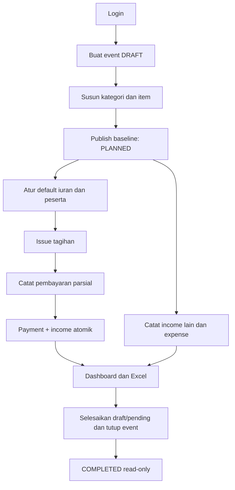

# PRD — EventFund v1.0

Status: spesifikasi implementasi. Tanggal: 10 November 2026. Pemilik keputusan produk: pemilik repository. Rujukan aturan detail: [BUSINESS_RULES](BUSINESS_RULES.md); data: [DATABASE](DATABASE.md); UX: [DESIGN_SYSTEM](DESIGN_SYSTEM.md).

## 1. Masalah, pengguna, dan tujuan

Bendahara event sering memakai spreadsheet berbeda untuk RAB, kas, daftar peserta, dan pembayaran. Angka mudah tercampur: anggaran disangka kas tersedia, pembayaran peserta dicatat dua kali, atau versi RAB lama tertimpa. EventFund menyatukan alur tersebut tanpa mengharuskan pengguna memahami akuntansi atau database.

Pengguna primer adalah pemilik/pengelola event yang juga bertindak sebagai bendahara. Satu akun dapat mengelola banyak event dengan kategori, satuan, sumber pemasukan, peserta, serta default iuran masing-masing. Peserta merupakan data operasional; peserta tidak otomatis memiliki akun login.

Tujuan v1: menyusun RAB fleksibel; mempertahankan baseline/revisi; membukukan kas aktual; mengetahui siapa yang belum lunas; menghasilkan Excel yang cocok dengan dashboard. Keberhasilan diukur melalui skenario penerimaan, bukan jumlah layar yang dibuat.

## 2. Keputusan terkunci dan rincian desain tambahan

| ID | Keputusan | Asal |
|---|---|---|
| D01 | Cakupan B: RAB + cashflow + iuran peserta | Pilihan pengguna |
| D02 | Model iuran B: default event dengan diskon/tambahan per peserta | Pilihan pengguna |
| D03 | Email/password; local development dahulu | Pilihan pengguna |
| D04 | Desktop spreadsheet editable; mobile kartu/form | Keputusan percakapan dan permintaan |
| D05 | Next.js App Router JavaScript JSX, Tailwind, shadcn Radix, PostgreSQL Prisma, Auth.js, Zod, ExcelJS, Vitest Playwright | Keputusan percakapan dan permintaan |
| D06 | Owner-only untuk MVP; tidak ada undangan/role editor aktif | Penegasan scope percakapan final |
| D07 | IDR saja, penyimpanan dua desimal; quantity tiga desimal; ROUND_HALF_UP per baris | Rincian desain paket |
| D08 | Satu tagihan utama non-VOID per peserta; penerbitan ulang setelah void, bukan banyak jenis iuran | Rincian desain paket |
| D09 | Reversal penuh append-only; tidak ada refund parsial atau vendor installment | Rincian desain paket |
| D10 | Semua mutasi event mengambil lock event; uang immutable setelah posting; replay idempotent tetap tersedia setelah penutupan | Rincian desain paket |
| D11 | Audit minimal dan lampiran transaksi lokal masuk v1; UI audit lengkap, kolaborasi, PDF ditunda | Rincian desain paket |
| D12 | Draft revisi disimpan snapshot terpisah; publish memperbarui working RAB secara atomik | Rincian desain paket |
| D13 | Registrasi lokal akun; tidak ada SMTP/reset email/OAuth dalam v1 | Rincian desain paket |

Rincian tambahan menyelesaikan bagian yang belum eksplisit di percakapan. Implementer tidak perlu mengulang pemilihan opsi tersebut. Perubahan substantif harus tercatat sebagai perubahan spesifikasi, bukan keputusan tersembunyi dalam kode.

## 3. Cakupan fitur

| Modul | Kebutuhan v1 | Di luar v1 |
|---|---|---|
| Akun | Registrasi, login, logout, password hash, rate limit | OAuth, email verification, reset via email, MFA |
| Event | Daftar, buat, metadata, status, reopen, arsip, duplikasi rencana | Kolaborasi, public share, multi-organization |
| RAB | Kategori/item/satuan bebas, qty/harga, subtotal, urutan, baseline, revisi dan perbandingan | Approval bertingkat, contingency otomatis, pajak khusus |
| Kas | Income draft/pending/received, expense draft/pending/paid, koreksi reversal, bukti | Double-entry accounting, bank reconciliation, gateway |
| Peserta | CRUD, identifier opsional, pencarian, arsip | Import massal/Excel, portal peserta |
| Iuran | Default snapshot, diskon/surcharge, issue/void, bayar parsial, reversal penuh, bukti | Banyak jenis tagihan, overpayment credit, refund parsial |
| Monitoring | RAB vs actual, kas, komitmen, tunggakan, proyeksi dan overbudget | Prediksi otomatis, analitik lintas organisasi |
| Laporan | Excel multi-sheet, tanggal/filter jelas, snapshot konsisten | PDF, email laporan terjadwal |
| Histori | Baseline/revisi, audit operasi finansial inti | Penjelajah audit global, histori semua klik |

Outstanding expense hanyalah catatan PENDING sederhana, bukan modul hutang/vendor ledger. Tidak ada opening balance tersembunyi: saldo awal dapat dicatat sebagai income non-iuran dengan sumber “Saldo awal”.

## 4. Kebutuhan fungsional

### FR-01 Akun dan isolation

Pengguna dapat registrasi email/password, masuk, dan keluar. Email case-insensitive unik; kesalahan login tidak mengungkap keberadaan akun. Setiap event dimiliki satu user. Daftar, detail, mutasi, lampiran, dan export hanya tersedia kepada pemilik. User B tidak boleh mengakses event A walaupun mengetahui UUID atau menebak URL.

### FR-02 Event lifecycle

Pembuatan event menghasilkan DRAFT, currency IDR, timezone Asia/Jakarta, settings iuran 0, serta satu sumber income sistem khusus iuran. Tanggal mulai/selesai dan lokasi opsional. Baseline mengubah DRAFT menjadi PLANNED. PLANNED dapat menjadi ACTIVE; PLANNED/ACTIVE dapat ditutup jika semua pekerjaan terbuka diselesaikan. COMPLETED dapat reopen ke ACTIVE dengan alasan. CANCELLED menyimpan histori dan terminal dalam MVP. Arsip terpisah dari status; event yang diarsipkan read-only.

Duplikasi event menyalin metadata pilihan, kategori/item aktif, sumber non-iuran, dan default settings ke event DRAFT baru. UUID baru; tanpa peserta, tagihan, kas, bukti, audit asal, atau baseline lama. Ownership tetap user yang melakukan duplikasi. Penghapusan fisik event tidak disediakan v1.

### FR-03 RAB dinamis dan revisi

Nama kategori, item, satuan, qty, unit price, notes, dan urutan dapat diatur. Subtotal diperlihatkan langsung sebagai preview, kemudian diverifikasi server saat simpan. DRAFT event dapat disimpan dalam batch atomik. Set baseline membekukan revision 1. Setelah itu edit RAB harus membuka draft revisi; published RAB tetap berlaku hingga publish. Draft revisi memiliki alasan, base_revision_no, dan version untuk mendeteksi stale write.

Publish menghasilkan snapshot immutable lengkap, nomor revisi bertambah, working tables terbarui, audit tercatat. Item yang dikeluarkan dari RAB diarsipkan; transaksi lamanya tetap terhubung dan masuk realisasi. Halaman perbandingan menampilkan baseline, current RAB, actual, delta, dan pengeluaran tak teranggarkan. RAB kosong boleh dibaseline dengan konfirmasi; tidak ada angka target yang di-hardcode.

### FR-04 Kas

Income memiliki sumber dinamis, amount, deskripsi, metode, status, dan tanggal terima bila posted. Expense memiliki deskripsi, amount, metode, tanggal bayar bila posted, serta satu budget_item opsional. Tanpa item, alasan tak teranggarkan wajib. DRAFT/PENDING dapat diedit atau dibatalkan. Posted tidak dapat diedit/dihapus. Reversal penuh harus mereferensikan original, nominal sama, alasan, tanggal efektif, dan key idempotency.

Overbudget dan saldo negatif menghasilkan warning yang harus diakui saat posting; transaksi valid tetap boleh tersimpan. Warning tidak menuntut pengguna memanipulasi RAB agar pengeluaran nyata tercatat. Bukti opsional: JPEG/PNG/PDF maksimal 5 MiB per file dan lima lampiran per transaksi. File tidak menjadi syarat pembukuan.

### FR-05 Peserta dan tagihan

Pengguna menambahkan peserta, mengisi identifier/kontak opsional, kemudian membuat tagihan DRAFT dari default saat itu. Final amount = base − discount atau base + surcharge. Alasan wajib untuk penyesuaian. Issue membekukan amount dan due date. Default berubah hanya memengaruhi draft baru; refresh default untuk draft lama harus eksplisit dan terkonfirmasi.

Tagihan ISSUED tidak diedit. Jika perlu koreksi, semua pembayaran aktif harus direversal terlebih dahulu, kemudian void dan terbitkan tagihan pengganti. Satu tagihan non-VOID per peserta mencegah penerbitan ganda. Void menyimpan histori. Tagihan nol sah, berstatus pelunasan PAID tanpa income fiktif. Peserta bertagihan terbuka atau memiliki pembayaran aktif tidak dapat diarsipkan.

### FR-06 Pembayaran

Input pembayaran melalui peserta → sisa tagihan → nominal/metode/tanggal → konfirmasi. Amount positif dan tidak melebihi sisa server. Event PLANNED/ACTIVE, tagihan ISSUED. Request membawa Idempotency-Key; exact replay mengembalikan receipt yang sama. Payment, income, audit, dan hasil idempotency satu transaksi database. Reversal payment sekaligus membentuk reversal income. Pembayaran tidak dapat dicatat melalui generic income route.

### FR-07 Dashboard dan laporan

Dashboard memperlihatkan current RAB, actual expenses net, cash balance, unpaid commitments, contribution receivable, dan funding gap dengan label yang membedakan rencana/aktual. Semua formula di BUSINESS_RULES. Excel memiliki Summary, RAB, Budget_Revisions, Incomes, Expenses, Participants, Charges, Payments. Uang dihitung server; report membaca income untuk kas dan payment hanya untuk detail iuran. Hasil report membawa generated_at, snapshot/as-of, timezone, currency, revision_no, dan filter.

## 5. Sitemap dan alur utama

```text
/register, /login
/events
/events/new
/events/[eventId]                     ringkasan
/events/[eventId]/budget              RAB aktif + editor draft
/events/[eventId]/budget/revisions    histori/perbandingan
/events/[eventId]/incomes
/events/[eventId]/expenses
/events/[eventId]/participants
/events/[eventId]/participants/[id]   tagihan + histori + bayar
/events/[eventId]/reports
/events/[eventId]/settings
```



## 6. Nonfunctional requirements

- Integritas mendahului respons optimistik. UI boleh preview subtotal tetapi menampilkan nilai server setelah commit. Tidak menyimpan nominal resmi dari hasil float client.
- Tidak ada horizontal scroll halaman pada lebar 360 px. Desktop RAB keyboard accessible; form touch target minimal 44 px. Status tidak dibedakan dengan warna saja.
- Target uji lokal yang direkam: event 1.000 item, 1.000 peserta, 5.000 cash entries; pagination 25/50/100; initial list dan save p95 di bawah 2 detik pada mesin uji yang dicatat, di luar instalasi/build. Export sampai 10.000 baris per sheet ditargetkan di bawah 30 detik; di atas batas ditolak dengan petunjuk mempersempit rentang. Ini target penerimaan terukur, bukan klaim performa saat ini.
- PostgreSQL development dan test terpisah. Migration dapat dijalankan dari database kosong. Backup/restore lokal diuji Phase 07. Semua test transaksi nyata memakai PostgreSQL.
- Tidak ada endpoint publik untuk data event. Logs cukup menyimpan request ID/error code, bukan secret atau detail kontak peserta. Error konsisten dan bisa ditindaklanjuti pengguna.
- Tidak mendukung offline write. Bila jaringan gagal, pertahankan input; retry posting memakai key yang sama dan payload yang sama sampai hasilnya diketahui.

## 7. Acceptance criteria produk

| ID | Given / When / Then | Fase |
|---|---|---|
| AC01 | Akun terdaftar / login valid / session tersedia; login salah generik dan dibatasi | 01 |
| AC02 | Dua pemilik / B mencoba ID event A termasuk export/file / 404 tanpa data bocor | 02,07 |
| AC03 | Qty 1.125 × harga 10.10 / simpan / subtotal 11.36, konsisten di Excel | 03,06 |
| AC04 | Baseline terbit / edit draft revisi / current RAB tetap; publish menghasilkan revision baru | 03 |
| AC05 | DRAFT income dan PENDING expense / lihat saldo / keduanya tidak masuk kas | 04 |
| AC06 | Expense melebihi budget / akui warning dan post / tetap tercatat, saldo serta variance benar | 04 |
| AC07 | 41 tagihan ISSUED × 310000 / rekap / total 12710000, bukan cash otomatis | 05 |
| AC08 | Tagihan 310000 / bayar 100000 lalu 150000 lalu 60000 / sisa 210000, 60000, 0 | 05 |
| AC09 | Satu request dibalas timeout / retry key identik / satu payment dan satu income saja | 05 |
| AC10 | Dua request berbeda total melebihi sisa / kirim paralel / paling banyak jumlah sah commit | 05 |
| AC11 | Reversal payment / commit / sisa naik dan kas turun tepat sekali; reversal kedua ditolak | 05 |
| AC12 | Default 310000 berubah 320000 / tagihan lama / tetap snapshot 310000 | 05 |
| AC13 | Diskon penuh / issue nol / PAID tanpa transaksi kas | 05 |
| AC14 | Event COMPLETED/archived / mutasi baru / 409; replay sukses lama tetap receipt sama | 02,05,07 |
| AC15 | Dataset sama / dashboard dan Excel snapshot sama / seluruh total sama hingga sen | 06 |
| AC16 | Lebar 360 dan 1440 / RAB dan pembayaran / kartu/form serta editable table dapat dipakai | 03,05,07 |
| AC17 | Pembayaran gagal setelah insert payment / rollback / payment, income, audit dan key tidak tertinggal | 05 |
| AC18 | Finalisasi dengan tunggakan / konfirmasi catatan / boleh jika tidak ada draft/pending; tunggakan tetap terlihat | 02,05 |

## 8. Risiko dan kontrol

Duplikasi klik dikendalikan unique idempotency dan transaction; balapan pembayaran dikendalikan lock; revisi tertimpa dikendalikan version; kebocoran antar event dikendalikan scoped query serta composite FK; laporan berbeda dikendalikan summary service dan database snapshot; file publik dikendalikan authorized download. Ketergantungan versi framework diselesaikan pada Phase 01 melalui smoke test login, Prisma transaction, dan build sebelum modul finansial ditambahkan.
